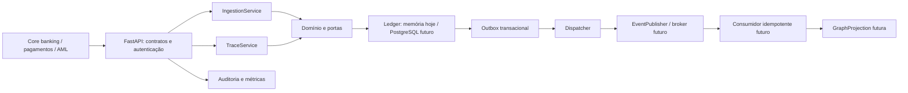

# OR TRACE

OR TRACE é um serviço de **Financial Crime Intelligence** para investigar a origem
observada, o percurso e o destino observado de recursos em redes de transações.
Entrega um núcleo executável em Python/FastAPI, com separação de domínio, serviços,
infraestrutura e APIs, pronto para evolução dentro de uma plataforma AML.

O armazenamento executável desta versão é em memória. PostgreSQL, banco de grafos e
broker têm contratos e desenho de integração; seus adaptadores duráveis ainda precisam
ser implementados. O serviço bloqueia inicialização fora de desenvolvimento sem
credencial e adaptador de ledger explícito. Esta base não declara prontidão para produção.

## Executar

Python 3.9+:

```sh
python3 -m venv .venv
source .venv/bin/activate
python -m pip install -e '.[dev]'
uvicorn or_trace.api.app:app --host 127.0.0.1 --port 8000
```

OpenAPI interativo: `http://127.0.0.1:8000/docs`; contrato JSON em `/openapi.json`
e cópia versionada em [docs/openapi.json](docs/openapi.json).
Configurações em [.env.example](.env.example); exporte as variáveis no ambiente
(o serviço não carrega `.env` automaticamente). Com OR_TRACE_API_KEY definido,
envie `X-API-Key` nos endpoints de negócio e métricas. Sem chave, somente o modo
development admite acesso aberto: execute localmente com dados sintéticos.

```sh
pytest -q
ruff check src tests examples
python examples/investigation.py
```

## 1. Objetivo

Reconstruir transaction lineage multi-hop e entregar trajetórias temporalmente
coerentes, indicadores de risco e evidências verificáveis. A unidade de investigação
é uma conta, uma janela temporal, uma moeda e uma direção de consulta.

## 2. Problema que resolve

Análises isoladas de transações perdem cadeias de dispersão, concentração, circulação
e movimentação rápida entre entidades. OR TRACE conecta esses fatos e oferece contexto
para investigação humana. Origens e destinos são observados na base disponível:
ausência de outra aresta não prova origem econômica ou beneficiário final.
Recursos fungíveis não têm identidade própria entre transferências: a linhagem atual
representa alcance temporal, não atribuição contábil definitiva do mesmo dinheiro.

## 3. Arquitetura



A consulta atual lê um snapshot do Ledger; o grafo é uma projeção futura reconstruível.
O domínio não importa FastAPI, drivers SQL ou bibliotecas de grafos. Mais detalhes e
decisões em [docs/architecture.md](docs/architecture.md).

## 4. Componentes

```text
src/or_trace/
  domain/          entidades, fatos, evidências, eventos e portas
  services/        ingestão, rastreamento e dispatcher da outbox
  infrastructure/ ledger de referência, conflitos e auditoria estruturada
  api/            aplicação FastAPI e schemas de entrada/saída
tests/            regras financeiras, atomicidade, contratos HTTP e segurança
examples/         investigação sintética executável
docs/             decisões, DDL de referência, OpenAPI e schema de evento
.github/workflows/ci.yml
```

Portas: Ledger é fonte de verdade e outbox; EventPublisher confirma publicação;
GraphProjection define aplicação idempotente e adjacências; AuditSink recebe registros.
Dependências são injetadas por `create_app(ledger=..., audit=..., api_key=...)`.
O adaptador de memória é seguro para threads no mesmo processo; perde dados ao reiniciar
e não deve ser usado com múltiplos workers.

## 5. Fluxo de dados

1. Registrar entidades e contas; referências desconhecidas são rejeitadas.
2. Receber lote de até 1.000 transações no contrato canônico.
3. Validar valores decimais positivos, IDs, timezone, moeda e referências; normalizar
   timestamps para UTC. Valores monetários chegam como strings, nunca floats.
4. Gravar lote e eventos atomicamente. Conflito em qualquer item desfaz o lote inteiro.
5. Retry idêntico é no-op; mesmo ID ou chave externa com conteúdo divergente retorna 409.
6. Dispatcher publica eventos e marca confirmação; consumidores deduplicam por event_id.
7. Consulta cria snapshot, seleciona janela/moeda e enumera caminhos com limites explícitos.
8. Regras geram evidências; resposta expõe linhagem, score, versão e ressalvas de atribuição.

A API aceita apenas o formato canônico. Conectores de formatos legados, arquivos,
streaming e mapeamento de identificadores devem transformar seus dados antes da ingestão.
Não há deduplicação fuzzy, resolução de identidade nem reversões nesta versão.

## 6. Modelo de domínio

| Objeto | Dados e invariantes |
|---|---|
| Entity | id, tipo pessoa/organização, nome de exibição |
| Account | id, entity_id, instituição; titular deve existir |
| Transaction | origem, destino, Decimal positivo, moeda, timestamp com timezone, origem técnica e external_id |
| Event | UUID, tipo, versão, agregado, correlação, instante do evento e payload |
| Path | contas e transações em sequência, moeda, teto monetário, duração, score e evidências |
| Finding | código da regra, peso, IDs verificáveis e explicação |

Uma entidade pode ter várias contas; a análise opera em contas e atravessa titulares
distintos. IDs de contas são globais nesta implantação. Transações são imutáveis;
transferências para a mesma conta são rejeitadas. Correções deverão usar eventos
compensatórios versionados em vez de mutação silenciosa.

## 7. APIs

| Método e endpoint | Contrato |
|---|---|
| POST `/v1/entities` | `{id, kind, display_name}`; 201 |
| POST `/v1/accounts` | `{id, entity_id, institution}`; 201 |
| POST `/v1/transactions` | `{transactions: [...]}`; 200 com accepted/duplicates |
| GET `/v1/accounts/{id}/trace` | origem (`backward`) ou destino/trajetória (`forward`) |
| GET `/health/live` | liveness pública, sem garantia de prontidão de dependências |
| GET `/metrics` | contadores e duração agregada em texto Prometheus |

Trace exige `start`, `end` (ISO 8601 com timezone), `currency`; aceita `direction`,
`max_hops` (padrão 5, máximo 10), `max_paths` (padrão 100, máximo 1.000).
Janela inclusiva. Resposta contém `paths`, `truncated`, `expansions`, `rule_version`,
`attribution_method` e `assumptions`. Cada caminho contém transaction_ids, account_ids,
bottleneck_amount, elapsed_seconds, risk_score, findings e terminated_by_cycle.
Valores decimais saem como strings JSON. Erros: 401 credenciais, 404 conta inexistente,
409 conflito idempotente e 422 entrada inválida. Cabeçalho X-Correlation-ID é gerado
pelo serviço e vincula requisição, auditoria e eventos de ingestão.

```sh
curl -X POST http://127.0.0.1:8000/v1/entities \
  -H 'Content-Type: application/json' \
  -d '{"id":"e1","kind":"organization","display_name":"Empresa sintética"}'
curl -X POST http://127.0.0.1:8000/v1/accounts \
  -H 'Content-Type: application/json' \
  -d '{"id":"a1","entity_id":"e1","institution":"TEST_BANK"}'
curl -X POST http://127.0.0.1:8000/v1/accounts \
  -H 'Content-Type: application/json' \
  -d '{"id":"a2","entity_id":"e1","institution":"TEST_BANK"}'
curl -X POST http://127.0.0.1:8000/v1/transactions \
  -H 'Content-Type: application/json' \
  -d '{"transactions":[{"id":"t1","source_account_id":"a1","destination_account_id":"a2","amount":"1000.00","currency":"BRL","occurred_at":"2026-01-01T10:00:00Z","source_system":"core","external_id":"pay-1"}]}'
curl -G http://127.0.0.1:8000/v1/accounts/a1/trace \
  --data-urlencode 'start=2026-01-01T00:00:00Z' \
  --data-urlencode 'end=2026-01-02T00:00:00Z' \
  --data-urlencode 'currency=BRL' --data-urlencode 'direction=forward'
```

## 8. Eventos

`transaction.ingested`, versão 1, é emitido somente para novos fatos. Envelope e payload
estão em [docs/transaction-ingested.schema.json](docs/transaction-ingested.schema.json).
occurred_at do envelope é o instante de aceitação; payload.occurred_at é o instante
financeiro. Valores são strings decimais. correlation_id vincula o evento à requisição;
aggregate_id é o ID da transação. Não há garantia de ordenação global: consumidores
devem tolerar atrasos, duplicatas e eventos fora de ordem.

Contrato de entrega: at least once. Não confundir deduplicação com exactly once.
PostgreSQL deve persistir ledger/outbox na mesma transação. Projeções devem usar inbox
ou chave de evento e transação atômica local. Ver [DDL de referência](docs/postgresql.sql).
Broker, workers agendados, retry/backoff, DLQ e monitoramento de lag são integrações futuras.
Eventos de investigação concluída e mudança de cadastro serão novos contratos versionados.

## 9. Exemplos de investigação

`python examples/investigation.py` cria A → B (1.000 BRL), B → C (950 BRL, +5 min),
C → A (920 BRL, +10 min), e B → D (50 BRL, +6 min). Retorna duas trajetórias:
A → B → C → A (circular, rapid movement e pass-through, score 75) e A → B → D
(rapid movement, score 20). Tetos por caminho são 920 e 50 BRL. O exemplo não depende
do servidor e não popula o armazenamento da API.

Para investigar origem de C, consultar C com `direction=backward`. A resposta ordena
as transações da mais antiga à mais recente, mesmo na busca reversa. Para dispersão,
procure três destinos distintos de uma conta na janela; para concentração, três origens.

| Regra v1.0 | Critério | Peso |
|---|---|---|
| fan_out | ≥3 destinos distintos da conta na janela/moeda | 15 |
| fan_in | ≥3 origens distintas da conta na janela/moeda | 15 |
| circular_flow | caminho temporal revisita uma conta | 30 |
| rapid_movement | transferências consecutivas em até 3.600 s | 20 |
| pass_through | par em até 1h e razão saída/entrada entre 0,90 e 1,10 | 25 |

Score soma cada regra uma vez e limita a 100; não é probabilidade de crime. Evidências
informam transações e contas que fundamentam a hipótese. Fan-in/out usa a janela inteira,
podendo incluir eventos fora do caminho; a explicação identifica esse escopo.
**Não somar tetos de caminhos sobrepostos.** Investigações devem confirmar saldos,
contexto econômico, qualidade da base e explicações legítimas antes de concluir.

## 10. Estratégia de testes

Testes unitários cobrem direção da linhagem, limites, ciclos, temporalidade, isolamento
de moedas, regras e montantes inválidos. Testes do adaptador verificam rollback de lote,
idempotência, referências e outbox. Testes HTTP exercitam autenticação, validação,
normalização UTC, decimais, correlação e métricas. Dispatcher é testado em sucesso e falha.
CI executa pytest e Ruff em Python 3.9/3.12.

Próximas camadas: testes de contrato comuns a todos os adaptadores; integração com
PostgreSQL/broker/grafo; concorrência e falhas entre commit/ack; propriedades de conservação
quando houver atribuição monetária; carga com grafos densos; datasets AML revisados e
medição de precisão/recall. DDL e adaptadores futuros não são validados pelos testes atuais.

## 11. Segurança, auditoria e explainability

Autenticação atual é chave de serviço com comparação constante; não oferece identidade
individual, multi-tenancy ou RBAC. Para operação bancária: OIDC/mTLS, escopos por função,
isolamento por instituição/caso, TLS, segredos gerenciados, criptografia em repouso,
minimização/mascaramento de dados pessoais e políticas de retenção conforme governança.
Isso exige implementação e revisão antes de dados reais; uma chave isolada não basta.

Auditoria estruturada registra timestamp, correlação, método, caminho, status, duração
e principal genérico; não registra corpos ou credenciais. IDs no caminho ainda podem ser
sensíveis e exigem retenção e acesso restritos. LoggingAuditSink usa o logger padrão;
não é armazenamento imutável. Uma implantação deve injetar sink durável, definir falha
fechada conforme política e preservar trilha de autor, caso, justificativa e acesso.
Exportação de evidências assinadas, hash de snapshot e histórico de versão de regras
são extensões futuras; respostas atuais são reproduzíveis apenas com o mesmo snapshot.

Métricas locais medem requisições, erros 5xx e duração acumulada. São por processo e
reiniciam com ele. Ainda faltam histogramas, tracing OpenTelemetry, readiness de dependências,
alertas de latência, saturação, rejeições, lag/outbox e falhas de auditoria. O algoritmo
limita hops/caminhos/expansões, mas o tamanho do ledger e a janela ainda exigem limites
operacionais. Rate limiting, orçamento de recursos e controle de consultas são requisitos
da próxima etapa.

## 12. Roadmap

1. **Persistência e eventos:** adaptador PostgreSQL, migrações executáveis, transações,
   inbox/outbox duráveis, workers com lease, broker, retry, DLQ e testes de falha.
2. **Grafo e escala:** projeção incremental, replay, watermark, consultas por índices,
   jobs de investigação, timeout, quotas e isolamento multi-tenant.
3. **Qualidade financeira:** reversões, reconciliação, saldos, resolução de entidades,
   FX explícito, regras por moeda, atribuição FIFO/proporcional conservando valores.
4. **Governança e investigação:** regras configuráveis aprovadas, evidência persistida
   e assinada, caso/analista, OIDC/RBAC, trilha imutável e retenção.
5. **Integração AML:** contratos versionados para case management, alertas, screening,
   scoring externo, observabilidade distribuída e validação operacional de modelos.

Cada etapa deve comprovar integridade, explicabilidade e comportamento sob falhas antes
de ampliar o escopo operacional. Os contratos desta base permitem trocar infraestrutura
sem introduzir dependências tecnológicas no domínio.
