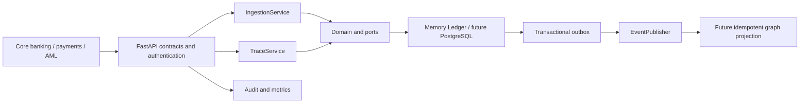

# OR TRACE

OR TRACE is an explainable financial-transaction lineage service for investigating observed origins, paths, and destinations across a payment network. It provides an executable Python/FastAPI core with domain, service, infrastructure, and API boundaries.

The current executable adapter stores data in memory. PostgreSQL, graph storage, and a broker have ports and reference contracts but no durable implementation. The service refuses non-development startup without an API credential and an explicit Ledger adapter. This repository does not claim production readiness.

## Run

Python 3.9+:

```sh
python3 -m venv .venv
source .venv/bin/activate
python -m pip install -e '.[dev]'
uvicorn or_trace.api.app:app --host 127.0.0.1 --port 8000
```

Interactive OpenAPI is available at `http://127.0.0.1:8000/docs`; the versioned contract is in [docs/openapi.json](docs/openapi.json). Configuration examples are in [.env.example](.env.example). When `OR_TRACE_API_KEY` is set, send `X-API-Key` to business and metrics endpoints. Open access is permitted only in development mode and should use synthetic data.

```sh
pytest -q
ruff check src tests examples
python examples/investigation.py
```

## Problem and investigation semantics

Single-payment reviews can miss dispersion, concentration, circular movement, and rapid pass-through behavior. OR TRACE connects recorded facts into temporally coherent multi-hop paths with evidence and explicit query budgets.

An origin or destination is only observed within the supplied dataset. Missing edges do not prove economic origin, final destination, or beneficial ownership. Because money is fungible, temporal reachability is not definitive attribution of the same funds. Each path's minimum edge amount is an upper bound, not a conserved allocation; overlapping path amounts must not be added.

## Architecture



The Ledger is the source of truth; a graph database is a rebuildable future projection. The domain does not import FastAPI, SQL drivers, or graph libraries. See [engineering decisions](docs/architecture.md).

## Data flow and guarantees

1. Register entities and accounts; unknown ownership references are rejected.
2. Ingest up to 1,000 canonical transactions per batch.
3. Validate positive decimal strings, identifiers, time zones, currency, and account references; normalize timestamps to UTC.
4. Commit the complete batch and outbox events atomically. Any conflict rolls back the batch.
5. Identical retries are no-ops; a reused ID or external key with different content returns a conflict.
6. Publish events at least once; downstream consumers must deduplicate atomically.
7. Trace a Ledger snapshot within one time window, currency, direction, and explicit work budget.
8. Return paths, rule evidence, truncation, analyzed transaction count, a canonical snapshot fingerprint, and conservative residual-capacity allocations.

The fingerprint supports reproducibility of the analyzed snapshot. It is not a digital signature, an attestation of upstream completeness, or a substitute for governed data lineage.

## API

| Method and endpoint | Purpose |
|---|---|
| `POST /v1/entities` | Register `{id, kind, display_name}` |
| `POST /v1/accounts` | Register `{id, entity_id, institution}` |
| `POST /v1/transactions` | Atomically ingest canonical transactions |
| `GET /v1/accounts/{id}/trace` | Trace forward or backward paths |
| `GET /health/live` | Public process liveness |
| `GET /metrics` | Aggregate Prometheus-style counters |

Trace requires time-zone-aware `start` and `end` plus a three-letter uppercase `currency`. It accepts `direction`, `max_hops` (1–10), `max_paths` (1–1,000), and `max_expansions` (1–10,000). The response also includes conservative allocations that consume each observed transfer capacity once in deterministic path order. This is a reproducible allocation policy, not proof of economic ownership. Decimal amounts are JSON strings.

Errors include 401 for credentials, 404 for an unknown account, 409 for idempotency conflicts, and 422 for invalid input. The generated `X-Correlation-ID` links the request to audit records and ingestion events.

```sh
curl -X POST http://127.0.0.1:8000/v1/entities \
  -H 'Content-Type: application/json' \
  -d '{"id":"e1","kind":"organization","display_name":"Synthetic Entity"}'

curl -X POST http://127.0.0.1:8000/v1/accounts \
  -H 'Content-Type: application/json' \
  -d '{"id":"a1","entity_id":"e1","institution":"TEST_BANK"}'

curl -G http://127.0.0.1:8000/v1/accounts/a1/trace \
  --data-urlencode 'start=2026-01-01T00:00:00Z' \
  --data-urlencode 'end=2026-01-02T00:00:00Z' \
  --data-urlencode 'currency=BRL' \
  --data-urlencode 'direction=forward'
```

## Rules and evidence

The current rule set identifies fan-in, fan-out, circular flow, rapid movement, and pass-through hypotheses. The score adds each distinct rule once and caps at 100. It is not a probability of criminal activity. Fan-in/out evidence can use activity elsewhere in the query window; explanations disclose this scope.

`python examples/investigation.py` builds a synthetic circular and dispersal scenario and prints the resulting paths without starting the API.

## Events

New transactions create versioned `transaction.ingested` events. The envelope and payload schema are in [docs/transaction-ingested.schema.json](docs/transaction-ingested.schema.json), and a PostgreSQL reference design is in [docs/postgresql.sql](docs/postgresql.sql). Delivery is at least once, not exactly once. Global ordering, worker scheduling, retry/backoff, dead-letter handling, and broker monitoring are future integrations.

## Verification and limitations

Tests cover temporal direction, cycles, query limits, currency isolation, rules, atomic ingestion, retries, references, outbox behavior, authentication, UTC normalization, decimals, correlation, metrics, and evidence snapshot fingerprints. CI runs pytest and Ruff on Python 3.9 and 3.12.

Before production use, implement durable storage and migrations, enterprise identity and authorization, encryption and retention, indexed queries, tenant quotas, projection watermarks, security and load testing, reconciliation-aware attribution, governed rules, labelled-dataset evaluation, operational monitoring, and reviewed deployment controls.
